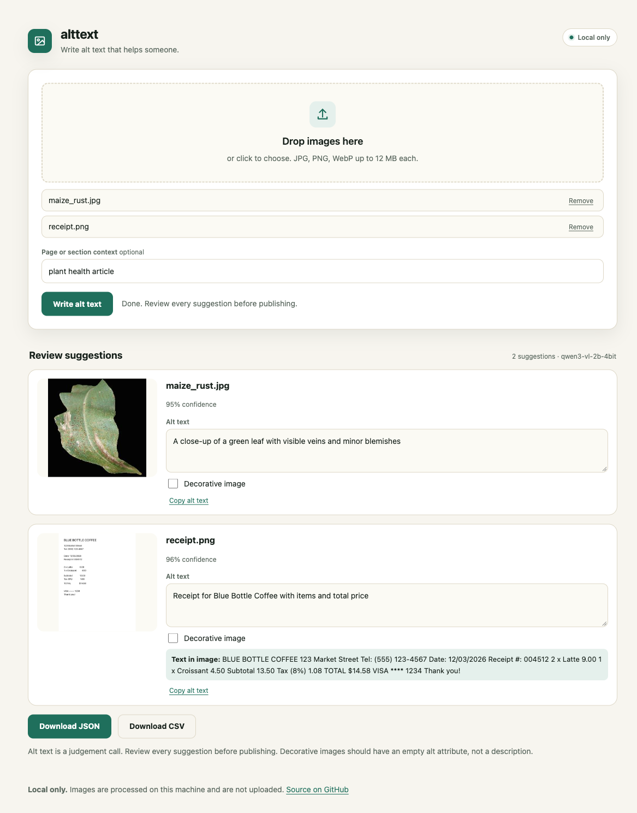

# alttext

Write alt text that helps someone.

Point alttext at a folder, an HTML page, or a Markdown file. It finds images that are missing alt text, writes a draft for each one with a local vision model, and gives you a reviewable report.



Status: v0.1.1. Local model, local review, no upload.

## Why

See [how this compares](docs/comparison.md) with the closest tools.

Missing alt text is one of the most common accessibility failures on the web. A blind reader gets "image" or nothing at all. Most alt-text tools are one-image demos that send the image to a paid API.

alttext is built for batches and for review. It writes a first draft, flags decorative images and text inside images, and lets a human fix the wording before publishing.

## What it does

- Scans image folders, HTML files, Markdown files, and public HTML pages without a browser.
- Finds missing alt attributes and empty descriptions.
- Writes alt text with Qwen3-VL-2B, 4-bit, through Apple MLX.
- Flags images that contain important text.
- Lets you mark an image as decorative.
- Exports JSON, CSV, and a Markdown report.
- Patches the alt attributes in an HTML file.

## Quickstart

```bash
git clone https://github.com/iambiniyam/alttext.git
cd alttext
uv venv && source .venv/bin/activate
uv pip install -e ".[dev,model]"
python scripts/download_model.py
alttext scan ./site
alttext generate ./site --out report.json --html site/index.html --html-out site/index.fixed.html
alttext serve
```

The 4-bit MLX model is about 1.7 GB. It needs Apple Silicon. The first request loads it in a few seconds, then each image takes about 9 to 18 seconds on an 8 GB M-series Mac.

If you do not want the model, use the deterministic fallback:

```bash
alttext generate ./site --model heuristic
```

## CLI

```bash
# list missing and present alt text
alttext scan ./images
alttext scan ./index.html
alttext scan ./notes.md

# audit a public page without a browser
alttext scan-url https://example.com --fail-on-missing

# write suggestions and a report
alttext generate ./images --out report.json

# apply a report to an HTML file
alttext apply report.json index.html --out index.fixed.html

# check the local runtime
alttext doctor
```

## Web UI

`alttext serve` opens a local page with:

- drag and drop, file picker, and paste for up to 20 images
- optional page or section context
- editable alt text for every image
- a decorative toggle
- text-in-image notes
- JSON and CSV export
- loading, error, and empty states
- automatic dark mode and mobile layouts
- keyboard access and visible focus

The browser does not upload the images. The page sends them to the local FastAPI process only.

## Model

| Item | Value |
|---|---|
| Model | Qwen/Qwen3-VL-2B-Instruct, 4-bit MLX |
| License | Apache 2.0 |
| Size | about 1.7 GB |
| Runtime | mlx-vlm on Apple Silicon |
| Output | one JSON object per image with alt, decorative, text_in_image, confidence, and notes |

The full fp16 model is about 4.3 GB and does not fit safely on an 8 GB laptop. The 4-bit MLX build is the version tested here. On a machine without Apple Silicon, use the heuristic fallback or run the model on a larger host.

The model is optional. The heuristic backend exists so tests and demos run without a download. It is not good alt text and should never be published.

## Accessibility rules

The prompt asks for the image purpose and information, not visual style. It avoids "image of" and keeps the result under 160 characters. It can mark an image decorative. It copies important text into a separate field so the reviewer can decide whether the text belongs in the alt attribute.

Decorative images should have `alt=""`, not a description. The UI makes that explicit.

## Limits

- The model writes a draft. A human must review it.
- Text in images may be misread. Check it.
- It scans local HTML and Markdown. It does not crawl a live website yet.
- Remote images are skipped and listed as warnings.
- Complex charts need a human-written long description, not a short alt string.
- The model can be wrong about the image purpose, especially in a dense interface.
- `scan-url` fetches HTML only. It does not run JavaScript or audit images behind a login.
- Screenshots are described by their visual content, not by the app name. Add context and review.

## Privacy

- No network calls at runtime.
- The CLI reads local files.
- The web UI sends images to 127.0.0.1 only and does not store them.
- The model is downloaded once.

## Packaging

alttext is a Python package. It is not an npm package because the model runtime is Python.

- PyPI: `pip install alttext`
- Release wheel: `pip install https://github.com/iambiniyam/alttext/releases/download/v0.1.1/alttext-0.1.1-py3-none-any.whl`
- GitHub Action: `uses: iambiniyam/alttext@v0.1.0`
- Model download: `python scripts/download_model.py`

The release workflow uses PyPI Trusted Publishing. A maintainer configures the PyPI project and the `pypi` environment once, then sets the repository variable `PUBLISH_PYPI=true`. No API token is stored in the repository. Until that setup exists, install the wheel attached to the GitHub release.

The GitHub Action runs the scanner in CI:

```yaml
- uses: iambiniyam/alttext@v0.1.0
  with:
    path: ./site
```

## Tests

```bash
pytest -q
```

The suite has 11 tests covering image folder scanning, HTML and Markdown parsing, URL scanning, report merging, HTML patching, text-in-image filtering, and the deterministic fallback. The model is not required for tests.

## Roadmap

- generate long descriptions for charts and infographics
- batch review with keyboard shortcuts
- support for Word and PDF documents
- a public benchmark of alt-text quality

## Related tools

- [redact](https://github.com/iambiniyam/redact): offline PII redaction.
- [snap2sheet](https://github.com/iambiniyam/snap2sheet): receipts to spreadsheets.
- [find-local](https://github.com/iambiniyam/find-local): semantic file search.
- [shamba](https://github.com/iambiniyam/shamba): offline plant health scanner.

## License

MIT. The Qwen model has its own Apache 2.0 license. See [THIRD_PARTY.md](THIRD_PARTY.md).
